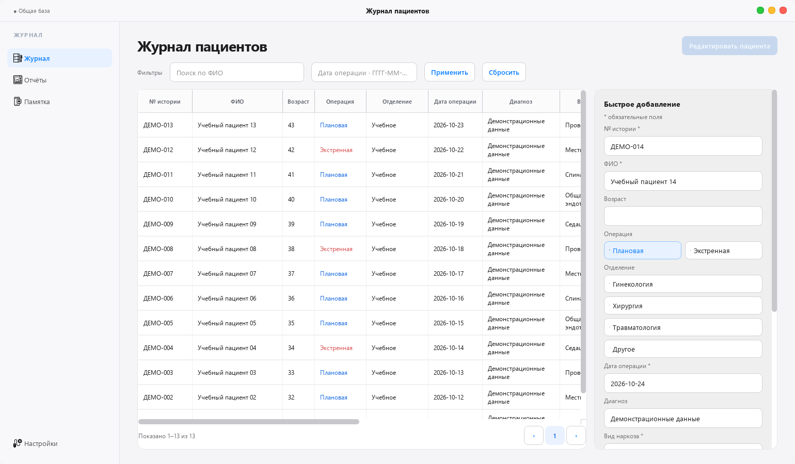

<p align="center">
  <a href="./README.md">Русский</a> · <a href="./README.en.md">English</a> · <strong>简体中文</strong> · <a href="./README.ja.md">日本語</a> · <a href="./README.de.md">Deutsch</a>
</p>

<h1 align="center">患者日志</h1>

<p align="center">
  <strong>在同一本日志中管理手术与麻醉记录。</strong><br>
  面向 Windows 的应用，使用本地或网络共享中的 SQLite 数据库，支持病例记录、检索与统计。
</p>

<p align="center">
  <a href="./app_version.py"></a>
  
  
  
</p>

<p align="center">
  
</p>

*当前应用的截图，所有数据均为虚构。应用界面为俄语；这些 README 译本仅涵盖文档。*

## 功能

- **病例记录。** 记录择期和急诊手术；同一患者的多次手术分别保存为独立病例。
- **检索。** 按患者姓名和手术日期筛选，编辑或删除选中的记录。
- **麻醉时长。** 自动计算持续时间，支持跨午夜的情况。
- **报表。** 按指定时间段统计麻醉类型、医生及护士的相关数据。
- **共享基础数据。** 管理麻醉类型及人员列表，按周备份，并从共享文件夹获取更新。

**使用方式：** 日志文件夹可以位于本机或网络共享中。同一本日志在同一时间仅允许 **一台工作站** 使用。

## 快速开始

从源码运行需要 **Windows 10/11 和 Python 3.10+**。界面使用 PySide6 构建。

```powershell
git clone https://github.com/Donkiton/Oper-Journal.git
cd Oper-Journal
python -m venv .venv
.\.venv\Scripts\python.exe -m pip install -r requirements.txt
.\.venv\Scripts\python.exe modern_app.py
```

首次启动时，请先创建一个空的测试文件夹，然后在连接对话框中选择它。应用会创建数据库及子文件夹。添加一条虚构病例后，尝试检索功能和“报表”（«Отчёты»）页面。

## 详细说明

<details>
<summary><strong>数据存储与备份</strong></summary>

所选日志文件夹包含：

| 路径 | 内容 |
|---|---|
| `data/journal.db` | SQLite 病例数据库 |
| `settings.json` | 共享设置和基础数据列表 |
| `backups/` | 数据库备份 |
| `.journal.lock` | 防止同时使用的锁文件 |
| `UPD/` | 更新清单和版本压缩包 |

连接日志时，每个 ISO 周创建一次备份。这项检查在应用运行时执行，并非独立的后台定时任务。

打包版将日志路径保存在 `%LOCALAPPDATA%\JornalPatients\connection.json` 中；从源码运行时则使用代码目录中的 `connection.json`。打包版还会在本机保留运行日志和更新缓存。

</details>

<details>
<summary><strong>基础数据列表与自定义输入</strong></summary>

在“设置”（«Настройки»）中，每个基础数据列表下方都有“允许输入自定义值”（«Разрешить ввод своего значения»）复选框。麻醉类型默认不允许自定义输入，医生和护士默认允许。

禁用自定义输入后，只能选择列表中的值。原记录中不在列表内的历史值可以保持不变并保存。这些设置由所选日志共享。

</details>

<details>
<summary><strong>Windows 应用构建与更新</strong></summary>

创建 `.venv` 后，在项目目录中运行：

```powershell
.\.venv\Scripts\python.exe -m pip install -r requirements-build.txt
.\.venv\Scripts\python.exe build_release.py
```

输出为 `dist/JournalPatients/` 文件夹和 `dist/JournalPatients-1.0.9.zip` 压缩包。迁移时请复制整个应用文件夹。版本以 [`app_version.py`](./app_version.py) 为准；源码版本可能高于最新的 GitHub Release。

将更新放入日志的共享文件夹：

```powershell
.\.venv\Scripts\python.exe build_release.py --publish-root "\\server\share\Jornal-oper"
```

脚本会创建压缩包和 `UPD/latest.json`。打包版在退出时检查更新；如果数据库结构要求更新的应用版本，则会在主窗口打开前检查。安装前会校验压缩包大小和 SHA-256。

</details>

<details>
<summary><strong>开发与测试</strong></summary>

```powershell
.\.venv\Scripts\python.exe -m unittest discover -s tests -v
```

测试涵盖数据库迁移、同一患者的重复病例、基础数据列表、人员姓名、下拉列表以及启动时的更新流程。

| 文件 | 用途 |
|---|---|
| [`modern_app.py`](./modern_app.py) | PySide6 界面与日志操作 |
| [`database_schema.py`](./database_schema.py) | SQLite 数据库结构与迁移 |
| [`update_system.py`](./update_system.py) | 更新检查与安装 |
| [`build_release.py`](./build_release.py) | 构建并将版本放入共享文件夹 |
| [`tests/`](./tests/) | 回归测试 |

贡献规则见 [`CONTRIBUTING.md`](./CONTRIBUTING.md)（俄语）。示例和测试只能使用虚构数据。

</details>

## 使用前须知

本应用不能替代医疗信息系统。应用未内置用户账户或角色，文件夹访问由 Windows 权限控制。使用真实患者数据前，请先取得所在机构的 IT 和个人数据保护负责人的同意。

请按照 [`SECURITY.md`](./SECURITY.md) 中的说明报告安全漏洞。图标来源见 [`ATTRIBUTION.md`](./ATTRIBUTION.md)。目前尚无 `LICENSE` 文件，使用和分发条款尚未通过开源许可证明确。
